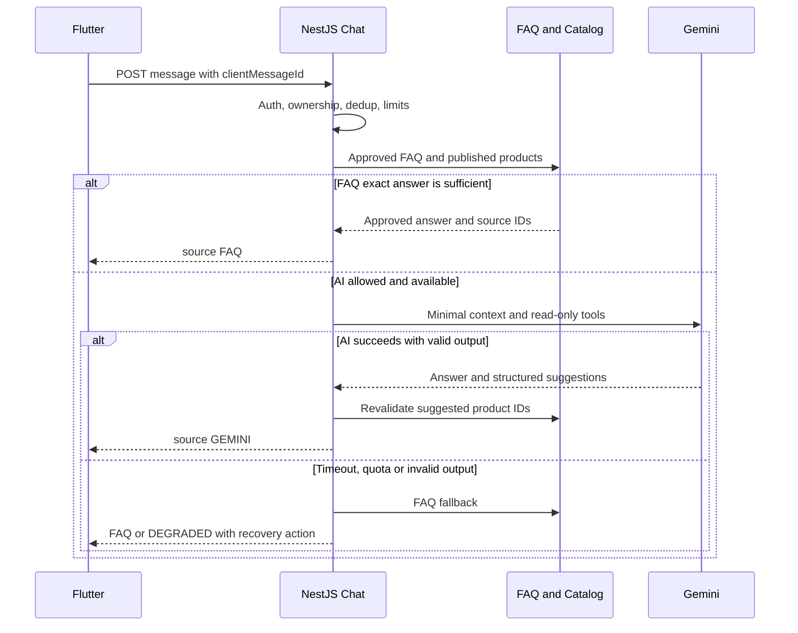

# REST contract v1 - PROPOSED, chưa triển khai

> Scope update 2026-11-04: This document contains historical milestones. For the current FE scope, removals and remaining integration work, use [FE-SCOPE-CLEANUP.md](../FE-SCOPE-CLEANUP.md). Blog/digital products/advanced marketing are excluded; do not restore them from this history.

Đọc [ADR và approval register](PHASE-1.md), [data model/state](DATA-MODEL.md) trước khi duyệt. Endpoint dưới đây là danh mục thiết kế, không phải chức năng đang chạy. Các endpoint conditional chỉ mở khi D tương ứng được duyệt.

## 1. Quy ước chung

- HTTPS, prefix `/api/v1`; JSON camelCase. Provider webhook có response protocol riêng, không bọc envelope chung.
- Customer ownership từ authenticated principal, không nhận `userId`/`authorId`/`role` làm quyền trong request body.
- Item response `{data, meta:{requestId}}`; list response `{data:[],meta:{requestId,page,pageSize,total,totalPages}}`. Page 1-based, stable sort có ID tie-breaker; giới hạn pageSize do technical config được duyệt.
- Customer catalog pageSize=6 và admin pageSize=5 có thể giữ cho UI; API hỗ trợ pageSize để không tải tất cả rồi phân trang lại ở frontend.
- `Idempotency-Key` bắt buộc cho create order, payment attempt và command tài chính/Custom nhạy cảm. Cùng key khi retry chính cùng ý định; không sinh key mới cho mỗi network retry.
- Command mutable nhận `expectedVersion`; stale trả 409 RESOURCE_VERSION_CONFLICT. Không nhận PATCH status arbitrary.
- DTO whitelist/reject field ngoài schema; enum lạ trả validation error. GET không đột biến tài nguyên commerce.
- ISO UTC cho timestamp; date-only cho birthday. Tiền là integer VND theo giới hạn an toàn trong DATA-MODEL.
- `availableActions` là hỗ trợ UX, không thay permission/state guard. FE không tự suy hành động chỉ bằng tên enum.

### Lỗi chung

```json
{
  "error": {
    "code": "OUT_OF_STOCK",
    "message": "Số lượng sản phẩm đã thay đổi. Vui lòng kiểm tra lại giỏ hàng.",
    "fieldErrors": [],
    "details": {
      "variantId": "20000000-0000-4000-8000-000000000001",
      "requestedQuantity": 2,
      "availableQuantity": 1
    },
    "retryable": false
  },
  "meta": {"requestId": "req-example"}
}
```

| HTTP | Codes tiêu biểu | FE xử lý |
| --- | --- | --- |
| 400 | VALIDATION_ERROR, INVALID_CALLBACK | Giữ draft, lỗi cạnh field; callback dùng provider protocol riêng |
| 401 | UNAUTHENTICATED, SESSION_EXPIRED | Refresh single-flight theo policy; không thành công thì đăng nhập lại |
| 403 | FORBIDDEN, ACCOUNT_BLOCKED | Không retry tự động hoặc giả thành empty |
| 404 | NOT_FOUND | Trạng thái không khả dụng; không fallback sang sản phẩm/đơn khác |
| 409 | OUT_OF_STOCK, QUOTE_STALE, QUOTE_ALREADY_USED, RESOURCE_VERSION_CONFLICT, INVALID_STATE_TRANSITION, ALREADY_REVIEWED, IDEMPOTENCY_CONFLICT | Reload/requote có kiểm soát; không tự chấp nhận thay đổi tổng |
| 422 | VOUCHER_EXPIRED, VOUCHER_NOT_APPLICABLE, VOUCHER_LIMIT_REACHED, DEFAULT_ADDRESS_DELETE_FORBIDDEN, PAYMENT_METHOD_NOT_AVAILABLE | Giữ dữ liệu nhập, giải thích và cho chọn lại |
| 429 | RATE_LIMITED | Respect Retry-After; không vòng lặp gửi thanh toán/chat |
| 503 | PAYMENT_PROVIDER_UNAVAILABLE, SHIPPING_UNAVAILABLE, DEPENDENCY_UNAVAILABLE | Retry hữu hạn đúng loại request; không chuyển trạng thái thành paid/failed dựa lỗi mạng |

`details` được lọc theo quyền, không trả payload provider, bank statement, nội dung người khác hoặc stack trace. Message phục vụ hiển thị; FE dựa code cho logic, không parse tiếng Việt.

## 2. Endpoints theo module

Ký hiệu quyền: P public; U authenticated + ownership; A admin permission; S provider/system verification. Thao tác readonly có thể thuộc P0 trước; thao tác ghi chỉ triển khai sau approval gate.

### Identity và profile

| Method/path | Quyền | Mục đích/ghi chú |
| --- | --- | --- |
| GET /auth/capabilities | P | Login methods, registration/reset có khả dụng, transports được hỗ trợ; không lộ secret |
| POST /auth/register | P | Theo D01; response authenticated hoặc verificationRequired, không tự cấp admin |
| POST /auth/login | P | Credentials + client transport đã chốt; rate limit và chống enumeration |
| POST /auth/refresh | Session | Rotation theo D01-D02; web cookie+CSRF, mobile credential riêng |
| POST /auth/logout | Session | Revoke phiên hiện tại; không xóa giỏ/đơn |
| GET /me | U | User UUID, profile, effective permissions, session transport |
| PATCH /me/profile | U | Name/phone/gender/birthday/avatarMediaId; email/password không sửa chung |
| POST /auth/password-reset-requests; POST /auth/password-reset-confirmations | P | Conditional D01, response chống dò tài khoản |
| POST /auth/password-change | U | Conditional D01, tái xác thực và session policy |

Không mở `/admin/register`. Admin login dùng chung identity nhưng kiểm admin permission trước vào admin API; role không chỉ do route frontend lựa chọn.

### Catalog, cart và địa chỉ

| Method/path | Quyền | Contract chính |
| --- | --- | --- |
| GET /categories | P | Categories published |
| GET /products?q=&categoryId=&kind=&sort=&page=&pageSize= | P | Published only; price sort/min/max/rating semantics cần ghi trong OpenAPI |
| GET /products/:productId | P | Detail + variant options + media + review summary; unpublished trả 404 |
| GET /products/:productId/variants | P | Variant ID/SKU/options/price/availability; không generate tổ hợp không bán |
| GET /me/cart | U | Cart/version/lines, server display prices, availability; chưa phải quote |
| POST /me/cart/items | U | variantId, quantity; add semantics ghi rõ là tăng số lượng, replay cùng key không tăng lại |
| PATCH /me/cart/items/:itemId | U | quantity tuyệt đối, expectedVersion; không gửi price |
| DELETE /me/cart/items/:itemId | U | Remove line; repeat delete không tạo tác động mới |
| GET /me/addresses | U | ID/version/default; không tự mutate checkout draft |
| POST /me/addresses | U | Address DTO, makeDefault explicit theo rule đã duyệt |
| PATCH /me/addresses/:id | U | Fields/version; không sửa đơn cũ |
| PUT /me/addresses/:id/default | U | Atomic đổi default; expectedVersion |
| DELETE /me/addresses/:id | U | Chặn default theo quyết định hiện có |
| GET /address-regions?parentCode=&datasetVersion= | P | Nguồn và taxonomy theo D07; chưa chọn bộ dữ liệu |

POST cart add cũng yêu cầu Idempotency-Key vì là increment; nếu nhóm chọn upsert quantity thay add sẽ đổi contract trước implementation. Cart selection là local checkout draft; chỉ selected IDs gửi quote. Guest/merge endpoints chưa thiết kế cố định trước D12.

### Checkout, voucher, order, payment

| Method/path | Quyền | Contract chính |
| --- | --- | --- |
| POST /checkout/quotes | U | Selected cart item IDs + cart version + address/version + shipping choice + voucher inputs; server tính mọi tiền |
| GET /checkout/quotes/:id | U | Quote snapshot/expiry/totals/method availability |
| GET /me/vouchers | U | Có thể dùng/đã dùng/hết hạn theo server; không lấy date label của fixture để tính |
| POST /checkout/quotes/validate-vouchers | U | Optional preview eligibility theo cùng Quote service; không consume quota hoặc giữ hàng |
| POST /orders | U | quoteId + paymentMethod + note; Idempotency-Key. Không nhận client order code/amount/discount |
| GET /me/orders?status=&paymentStatus=&page=&pageSize= | U | Order list scoped by principal |
| GET /me/orders/:id | U | Order snapshot, payment summary, timeline, availableActions |
| POST /orders/:id/payment-attempts | U | Chỉ cùng method đã chốt trong intent; serialize retries; Idempotency-Key |
| GET /me/payment-intents/:id | U | Collection/resolution status và safe attempt data |
| GET /me/payment-attempts/:id | U | Trạng thái server, action/URL expiry; không raw callback |
| GET /payments/vnpay/ipn | S | Protocol PAY đã kiểm tra là GET query; không có user JWT, phải xác minh signature/provider fields |
| GET /payments/vnpay/return | S/browser | Landing return; không mutate Paid từ navigation; redirect allowlisted về app/web với opaque IDs |
| POST /payments/bank/webhooks/:connectionId | S | Conditional D06; signature/replay rules theo bank adapter thực, không giả định tồn tại |

Không tạo `/upload-proof`, `/confirm-paid` customer hoặc endpoint đổi paymentStatus bằng JSON tùy ý. `GET payment-intent` đọc state; scheduled/internal reconcile mới query provider, tránh đọc màn hình tạo flood provider calls. FE polling có backoff/limit và dừng khi background/terminal; thời lượng cụ thể chưa chốt.

Tạo order online và bỏ dòng giỏ tại order creation là **đề xuất D03**. Nếu nhóm chọn thời điểm khác, thay transaction/contract trước khi code; không trộn cả hai hành vi. Mọi quote phải revalidate tồn/giá/rule tại create order, không coi quote đã giữ tồn.

### Admin core

| Method/path | Permission | Mục đích |
| --- | --- | --- |
| GET /admin/products; GET /admin/products/:id | catalog:read_private | Search/filter/pagination; gồm hidden |
| POST /admin/products; PATCH /admin/products/:id | catalog:write | DTO whitelist/version; soft archive qua command được duyệt |
| POST /admin/products/:id/variants; PATCH /admin/variants/:id | catalog:write | Variant/price/options; không ghi đè order snapshot |
| POST /admin/inventory/adjustments | inventory:adjust | quantity delta + reason + expectedVersion + idempotency; không set balance tùy ý |
| GET /admin/orders; GET /admin/orders/:id | orders:read | Status đơn và paymentStatus/method filter riêng |
| POST /admin/orders/:id/transitions | orders:transition | Explicit CONFIRM/SHIP/DELIVER/CANCEL với expectedVersion; state guard |
| GET /admin/payment-intents; GET /admin/payment-intents/:id | payments:read | Có NEEDS_REVIEW, không trả secret |
| GET /admin/bank-transactions | payments:reconcile | Nguồn giao dịch đã ingest từ bank/verified statement |
| POST /admin/bank-transactions/:id/reconciliations | payments:reconcile | Match intent + reason/version; không nhận amount hay paid từ màn khách |
| POST /admin/orders/:id/cod-collections | payments:reconcile | Conditional D13: collection source/reference được duyệt, không suy từ delivery |
| GET /admin/vouchers; POST /admin/vouchers; PATCH /admin/vouchers/:id | vouchers:read/write | Rule DTO, version, enable/archive; nghiệp vụ D05 |
| GET /admin/customers; GET /admin/customers/:id | users:read | Thông tin tối thiểu theo quyền |

Import bank statement là **adapter/ops workflow chờ D06**, không mở API cho admin nhập tùy ý “giao dịch verified” rồi tự settle. Nếu chọn import, cần batch/source authenticity, parser bank-specific, duplicate detection và audit trước khi publish bank transaction để reconcile. Double approval cho tiền là lựa chọn D13, không tự bắt buộc hoặc tự bỏ qua.

### Custom, media, reviews, digital và chat - có approval gate

| Method/path | Quyền | Ghi chú |
| --- | --- | --- |
| POST /media/upload-intents; POST /media/:id/complete | U/A | Purpose/ownership/type/size; storage adapter chờ D10. `complete` server xác minh object, không tin client nói file đã hợp lệ |
| GET /me/custom-requests; POST /custom-requests; GET /me/custom-requests/:id | U | Description + mediaIds CUSTOM_REFERENCE; độc lập với payment |
| GET /admin/custom-requests; GET /admin/custom-requests/:id | custom:read | Approval D08 |
| POST /admin/custom-requests/:id/quotes | custom:quote | revision/terms, expectedVersion |
| POST /custom-requests/:id/quote-acceptances | U | quoteId/revision/version, Idempotency-Key; order conversion theo D08 |
| POST /admin/custom-requests/:id/rejections | custom:quote | Reason, version; không delete |
| GET /products/:id/reviews | P | Published reviews, rating/image filter/sort/page |
| GET /me/orders/:id/review-eligibility | U | Eligible/reviewed product IDs derive từ order thật |
| POST /orders/:id/reviews | U | productId/rating/text/mediaIds; server ownership+delivered+unique; không nhận author ID |
| GET /me/library | U | Entitlements server; conditional D09 |
| POST /me/entitlements/:id/access-grants | U | Recheck active entitlement, short-lived private access, audit; không public storage URL lâu dài |
| GET /faq?q=&category= | P | FAQ đã duyệt; không gọi Gemini chỉ để tìm FAQ |
| POST /chat/sessions; GET /me/chat/sessions/:id/messages | U | Conditional D09, sở hữu phiên |
| POST /chat/sessions/:id/messages | U | clientMessageId + text; response AI/FAQ/degraded; transport sync ban đầu đề xuất |

Review semantics một lần theo user/order/product, dù order có nhiều variant cùng product. Media phải ready và thuộc user; review transaction link media atomically, tối đa 5 JPG/PNG mỗi ảnh 5 MiB, kiểm bytes/MIME/codec ở server. Không áp limit này cho Custom/avatar. Tệp digital không cho mục đích CUSTOM_REFERENCE hoặc REVIEW_IMAGE.

## 3. DTO mẫu - giá trị minh họa, không phải seed/rule đã duyệt

### 3.1 ProductDetailDto

```json
{
  "data": {
    "id": "10000000-0000-4000-8000-000000000001",
    "name": "Khăn Len Merino Thủ Công",
    "kind": "PHYSICAL",
    "category": {"id": "10000000-0000-4000-8000-000000000002", "key": "fashion", "name": "Thời trang"},
    "publicationStatus": "PUBLISHED",
    "media": [{"id": "10000000-0000-4000-8000-000000000003", "url": "https://media.example.invalid/merino.jpg", "role": "COVER"}],
    "variants": [{
      "id": "20000000-0000-4000-8000-000000000001",
      "sku": "EXAMPLE-MERINO-CREAM-180",
      "options": [{"key": "color", "value": "cream", "label": "Kem"}, {"key": "size", "value": "180cm", "label": "180cm"}],
      "price": {"amount": 550000, "currency": "VND"},
      "availability": {"status": "IN_STOCK", "availableQuantity": 4},
      "version": 3
    }],
    "reviewSummary": {"average": 4.5, "count": 4},
    "version": 7
  },
  "meta": {"requestId": "req-example"}
}
```

SKU/stock trong ví dụ không phải dữ liệu catalog đã xác minh. Digital thay `kind` và thêm typed `digitalMetadata`; không suy quyền tải từ field này. Khi nhiều giá, list DTO có `priceRange`/`displayPrice` và variantCount; không ép vào một `Product.price` mà không biết đang chọn variant nào.

### 3.2 CreateCheckoutQuoteRequest → CheckoutQuoteDto

```json
{
  "source": "CART",
  "cartId": "30000000-0000-4000-8000-000000000001",
  "cartVersion": 9,
  "cartItemIds": ["30000000-0000-4000-8000-000000000002"],
  "address": {"addressId": "40000000-0000-4000-8000-000000000001", "version": 2},
  "shippingServiceId": "example-standard",
  "voucherCodes": ["EXAMPLE50"]
}
```

```json
{
  "data": {
    "id": "50000000-0000-4000-8000-000000000001",
    "version": 1,
    "source": "CART",
    "expiresAt": "2026-11-04T10:15:00Z",
    "items": [{
      "cartItemId": "30000000-0000-4000-8000-000000000002",
      "variantId": "20000000-0000-4000-8000-000000000001",
      "quantity": 1,
      "unitPrice": 550000,
      "lineSubtotal": 550000,
      "lineDiscount": 50000
    }],
    "totals": {"currency": "VND", "subtotal": 550000, "itemsDiscount": 50000, "shippingFee": 30000, "shippingDiscount": 0, "total": 530000},
    "allowedPaymentMethods": ["COD", "BANK_TRANSFER", "VNPAY"]
  },
  "meta": {"requestId": "req-example"}
}
```

Server lấy quantity từ đúng cart version, không từ subtotal client. Address là union `saved reference` hoặc `inline validated address` cho checkout tài khoản; inline không tự lưu vào sổ. `voucherCodes` array không có nghĩa đã duyệt cộng dồn: engine phải giới hạn theo D05. 30.000đ/50.000đ/expiry trên chỉ là ví dụ tính toán. Source BUY_NOW/DIGITAL cần D09/D15, không tự cho hàng số dùng COD.

### 3.3 CreateOrderRequest → OrderDto

Header: `Idempotency-Key: <client-generated-opaque-key>`; access credential theo transport D02.

```json
{
  "quoteId": "50000000-0000-4000-8000-000000000001",
  "quoteVersion": 1,
  "paymentMethod": "VNPAY",
  "note": "Vui lòng gọi trước khi giao."
}
```

```json
{
  "data": {
    "id": "60000000-0000-4000-8000-000000000001",
    "code": "EXAMPLE-ORDER-0001",
    "kind": "STANDARD",
    "status": "PENDING_CONFIRMATION",
    "createdAt": "2026-11-04T10:10:00Z",
    "version": 1,
    "items": [{
      "id": "60000000-0000-4000-8000-000000000002",
      "productId": "10000000-0000-4000-8000-000000000001",
      "variantId": "20000000-0000-4000-8000-000000000001",
      "nameSnapshot": "Khăn Len Merino Thủ Công",
      "skuSnapshot": "EXAMPLE-MERINO-CREAM-180",
      "variantLabelSnapshot": "Kem · 180cm",
      "quantity": 1,
      "unitPrice": 550000,
      "itemDiscount": 50000,
      "imageUrlSnapshot": "https://media.example.invalid/merino.jpg"
    }],
    "shippingAddressSnapshot": {"recipientName": "Khách minh họa", "phone": "0900000000", "street": "Địa chỉ minh họa", "cityLabel": "Khu vực minh họa", "districtLabel": null, "wardLabel": null},
    "totals": {"currency": "VND", "subtotal": 550000, "itemsDiscount": 50000, "shippingFee": 30000, "shippingDiscount": 0, "total": 530000},
    "payment": {"intentId": "70000000-0000-4000-8000-000000000001", "method": "VNPAY", "collectionStatus": "UNPAID", "resolutionStatus": "NORMAL", "amountDue": 530000},
    "availableActions": ["START_PAYMENT"]
  },
  "meta": {"requestId": "req-example"}
}
```

Create order trả 201; replay same key trả cùng resource/response. Order DTO thực còn có note và timeline phân trang/giới hạn hợp lý. Customer DTO không có internalNote, bank statement hoặc actor private data. Không dùng code display để gọi detail thay UUID.

### 3.4 Payment attempt và instructions

Request `POST /orders/:id/payment-attempts`: `{}` với Idempotency-Key. Server lấy method/amount từ intent; client không gửi callback URL tự do. Return target nếu cần là key enum allowlisted, không arbitrary URL.

```json
{
  "data": {
    "id": "80000000-0000-4000-8000-000000000001",
    "intentId": "70000000-0000-4000-8000-000000000001",
    "method": "VNPAY",
    "state": "PENDING",
    "action": {"type": "REDIRECT", "url": "https://sandbox.vnpayment.vn/paymentv2/vpcpay.html?example=not-a-real-payment"},
    "expiresAt": "2026-11-04T10:25:00Z"
  },
  "meta": {"requestId": "req-example"}
}
```

URL là minh họa không payable. BANK_TRANSFER cùng action union dùng `type=BANK_INSTRUCTIONS`, bank/account/holder/reference/amount/currency/qrImageUrl do server cấu hình và xác minh nguồn. COD không mở redirect/bank attempt; trạng thái thu tiền theo collection flow. Không tái sử dụng tài khoản/QR mẫu P2 làm tài khoản shop.

### 3.5 Các DTO còn lại

| DTO | Fields đề xuất | Validation quan trọng |
| --- | --- | --- |
| LoginRequest | identity, password, transport MOBILE_TOKEN/WEB_COOKIE | Methods thực theo capabilities; không role/admin flag tự cấp quyền |
| MobileSessionDto | user, accessToken, expiresAt, refreshToken hoặc provider session credential | HTTPS; không log/cache plaintext; không dùng DTO này cho web cookie |
| WebSessionDto | user, expiresAt, csrfToken nếu double-submit design được duyệt | Session/refresh qua Set-Cookie HttpOnly, không trả refreshToken JSON |
| ProfilePatch | expectedVersion, name, phone, gender nullable, birthday nullable, avatarMediaId nullable | Date ISO, phone normalization theo D01; email readonly trong màn hiện tại |
| AddressWrite | expectedVersion khi sửa, recipientName/phone, region dataset/codes/labels, street, makeDefault | Atomic default; server validate vùng; không default sang người mẫu |
| CartLineDto | id, variantId, productSummary, optionLabels, quantity, currentPrice, availability, version | Price hiển thị không phải giá quote đã lock |
| OrderTransitionRequest | action, expectedVersion, reasonCode, shipmentInput nếu SHIP | Actor từ session; không cho PATCH paymentStatus |
| ReconcileBankRequest | paymentIntentId, expectedIntentVersion, expectedTransactionVersion, reason | Bank transaction từ path; kiểm chưa allocate, account/direction/amount/currency/reference |
| ReviewCreateRequest | productId, rating, text nullable, mediaIds | Author từ principal; duplicate constraint; không order bất kỳ |
| CustomCreateRequest | description, referenceMediaIds, optional structured requirements | State/price/owner không do client chốt; giới hạn attachment D10 |
| CustomQuoteCreate | expectedRequestVersion, amount, currency, paymentTerms, deliveryEstimate, expiry nếu policy cho phép | Chưa chọn full/deposit; quote revision server |
| VoucherWrite | expectedVersion, code, type, fixedAmount hoặc percentageBps, cap, min, scope, dates, limits | Điều kiện/stack/version theo D05, không nhận field mâu thuẫn |
| ChatMessageRequest | clientMessageId, text | Dedup, length/rate limit, ownership; không client systemPrompt/secret/provider config |

## 4. VNPay verification, bank reconciliation và idempotency

### 4.1 VNPay adapter

Đã đọc [tài liệu PAY chính thức](https://sandbox.vnpayment.vn/apis/docs/thanh-toan-pay/pay.html) qua HTTPS local sau khi web reader timeout. Trang mô tả version 2.1.0; chưa có merchant sandbox để thử. Phải đối chiếu lại gói tích hợp thực được cấp trước implementation.

Các điểm protocol xác minh từ tài liệu: signed query, merchant/reference, amount nhân 100; IPN để cập nhật, Return URL phục vụ điều hướng; success kiểm cả response code và transaction status. Đề xuất chọn HMAC-SHA512 cho PAY 2.1.0 nếu cấu hình merchant phù hợp, canonical sort/encode theo spec, không tự viết lại bằng JSON stringify. Không coi sample code là policy kinh doanh.

Luồng thiết kế:

1. Tạo attempt durable trước khi phát hành URL; reference riêng từng attempt, amount theo intent immutable, provider env tách sandbox/production.
2. IPN chỉ nhận đúng loại/tham số dự kiến; validate size/types, signature constant-time với key đúng merchant/env, chống duplicate query parameter ambiguity. Không normalize/encode hai lần làm đổi signed data.
3. Lookup attempt bằng provider+merchant+reference; kiểm số tiền/currency và transaction identity. Success cần các mã thành công theo tài liệu merchant, không chỉ callback đi tới `/return`.
4. Ghi receipt/inbox và settle atomically theo DATA-MODEL. Duplicate được ack đúng protocol; callback bất nhất không downgrade tiền đã nhận. DB lỗi không trả ack thành công trước khi dữ liệu durable.
5. IPN response dùng `RspCode/Message` và quy ước provider, không envelope REST. Chi tiết mã ack/retry phải được đưa vào sandbox contract tests trước release.
6. Return landing dùng allowlist URL/app link, không đặt token auth/PII vào URL. App đọc intent server; nếu IPN chưa tới hiển thị đang xử lý, không hiển thị success từ query.
7. Server reconciliation query khi IPN thiếu/unknown theo provider API; worker backoff/budget, không client gọi trực tiếp. Network timeout giữ pending/unknown.
8. Success late hoặc second receipt: ghi tiền, NEEDS_REVIEW; không tự giao/refund. Đơn/giữ hàng hết hạn không chứng minh khách chưa trả tiền.

Danh sách trường phải kiểm/test: `vnp_TmnCode`, `vnp_TxnRef`, `vnp_Amount`, `vnp_CurrCode` khi có theo message type, `vnp_ResponseCode`, `vnp_TransactionStatus`, `vnp_TransactionNo`, `vnp_SecureHash`; không giả định mọi response chứa cùng field set. Currency được ràng buộc bằng intent/request VND nếu callback không gửi currency.

### 4.2 Bank transfer adapter - nguồn đối soát OPEN D06

Đây là luồng bank account transfer riêng, không nhận IPN VNPay. Tài khoản shop, QR generation và reference do backend cung cấp sau khi chốt bank connection; không dùng QR Figma.

Nguồn hợp lệ có thể là bank API/webhook ký xác thực hoặc verified statement do người có quyền đối chiếu trực tiếp từ ngân hàng. Manual verification phải được ghi là manual, không gắn nhãn đã xác minh mật mã. Adapter-specific authenticity và permission chưa có, nên chưa thể triển khai ingestion.

Reconciliation service đối chiếu account shop + credit direction + bank transaction ID + amount + currency + reference/order candidate. Reference trùng/mơ hồ, thiếu/thừa tiền, giao dịch đã match, reversed hoặc order không còn fulfillable → review. Matching theo reference không tự đủ bằng chứng paid. Retry cùng event/command không allocate lại. Bank reversal là financial event mới, không xóa receipt cũ; xử lý fulfillment/refund chờ D14.

Admin chỉ chọn giao dịch thực đã được ingest/verified để match, không upload ảnh khách hoặc tự nhập `confirmed=true`. Theo D13 có thể yêu cầu người xác minh khác người nhập; đây chưa phải rule đã chốt.

### 4.3 Server idempotency

- Key scope `(principalId hoặc trusted provider identity, operation, key)`; request hash bao gồm method/resource/canonical business payload. Không dùng access token làm key và không coi mỗi refresh token là user mới.
- Acquire record unique trong database; cùng key+hash: replay kết quả; khác hash: 409 IDEMPOTENCY_CONFLICT; đang xử lý: 409 REQUEST_IN_PROGRESS với retry hint. Không chạy command lần hai.
- Order/financial commit và lưu resource/result idempotency cùng transaction; external side effect qua outbox. Kết quả sau crash tìm được bằng key/resource, FE không tạo order mới vì mất response.
- TTL/retention key chờ duyệt; constraint quote/order, provider receipt, allocation vẫn giữ bảo vệ lâu dài. Không dùng cache memory/Redis-only làm bảo vệ duy nhất.
- Webhook duplicate có dedupe event riêng; không phụ thuộc Idempotency-Key do provider có thể không gửi header đó.
- N attempt/order được lưu lịch sử. Không sửa merchant reference của attempt cũ. Một attempt pending/unknown đang hoạt động phải được resolve/reuse theo policy trước khi bắt đầu attempt khác; race/late receipt vẫn có ledger handling.

## 5. Gemini orchestration và FAQ fallback - PROPOSED



- Key và provider config chỉ ở NestJS/secret store. Không nhúng Gemini key trong Flutter, web bundle hoặc response. Căn cứ: [Gemini key security](https://ai.google.dev/gemini-api/docs/api-key).
- Chat là read-only advisory. Gemini không có tool thực thi `createOrder`, `markPaid`, `setPrice`, `adjustInventory`, `grantEntitlement` hoặc tự gửi yêu cầu Custom. Suggestion phải qua UI confirm rồi gọi business API thông thường.
- Tool catalog chỉ published products và trường public; không gửi PII, internalNote, raw payment/bank data. FAQ/product content và input user là dữ liệu không tin cậy, không được override system policy.
- Ước tính len phải dùng công thức/range đã được nhóm duyệt; AI chỉ thu thập thông tin/giải thích, không tự phát minh công thức hoặc coi estimate là quote thương mại.
- Model/SDK, prompt, budget, timeout, số retry và confidence/fallback threshold D09; không gắn con số như đã chốt. Bounded timeout, backoff jitter cho lỗi transient; 401/403/config lỗi không retry vô hạn. 429 phân biệt rate limit/quota theo tín hiệu provider; circuit breaker tránh gọi lặp khi hết quota. Xem [Gemini troubleshooting](https://ai.google.dev/gemini-api/docs/troubleshooting).
- `ChatMessageDto`: id, clientMessageId, state COMPLETED/DEGRADED/FAILED, source GEMINI/FAQ/SYSTEM, text, citations FAQ/product IDs, suggestedActions, retryable/retryAfter nếu phù hợp. Không có câu trả lời thì nói chưa đủ thông tin và gợi ý hỗ trợ; không giả FAQ là AI.
- Message persist trước provider call để retry không gửi trùng; response dedupe theo session/clientMessageId. Nếu dùng async job sau này phải đổi response 202 + poll rõ, không tự giả định đã có SSE/WebSocket.
- FAQ fallback phải còn hoạt động khi Gemini không cấu hình/timeout/quota. Lưu lịch sử/retention/consent và admin support handoff chờ D09/D13.
