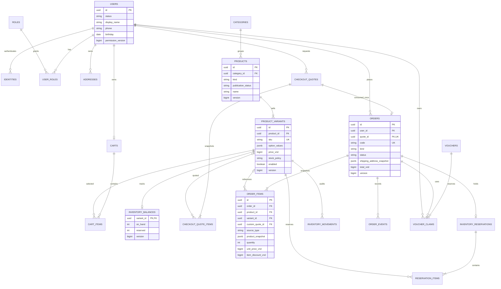
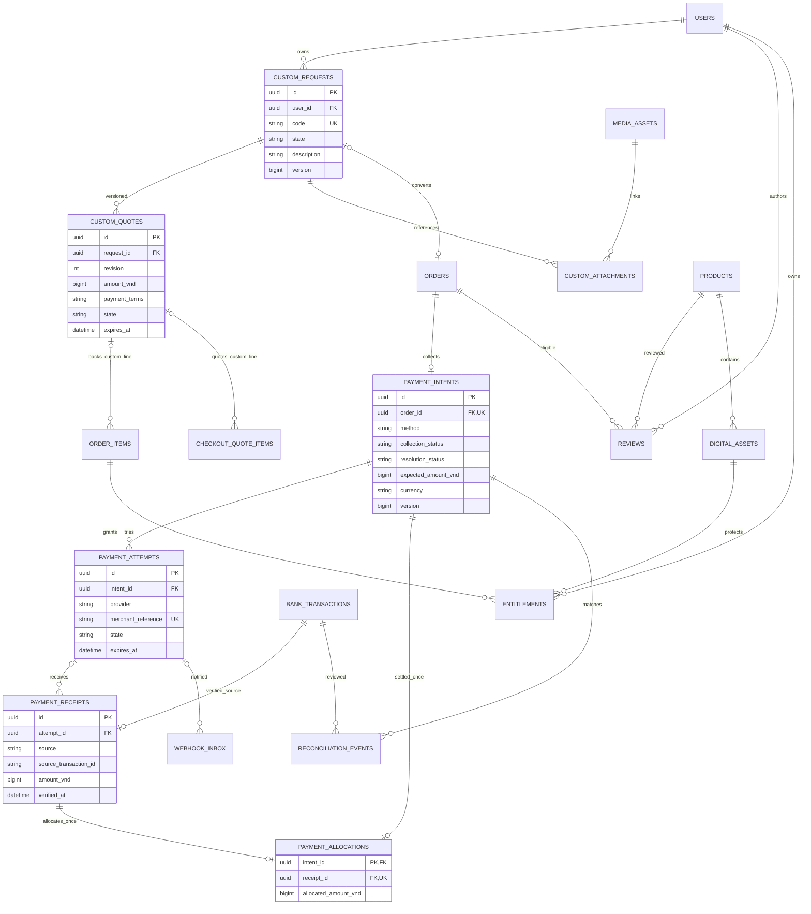

# PostgreSQL ERD và state model - PROPOSED

> Scope update 2026-11-04: This document contains historical milestones. For the current FE scope, removals and remaining integration work, use [FE-SCOPE-CLEANUP.md](../FE-SCOPE-CLEANUP.md). Blog/digital products/advanced marketing are excluded; do not restore them from this history.

Trạng thái và approval register: [PHASE-1.md](PHASE-1.md). Không phải DDL/migration; không có bảng nào đã được tạo. Các ID là UUID server; tên constraint bên dưới là đặc tả, không phải SQL đang chạy.

## 1. Kiểu dữ liệu và bất biến chung

- Money: PostgreSQL `bigint`, đơn vị nguyên VND; JSON integer phải nằm trong miền số nguyên an toàn của JavaScript. Không float cho tiền; VNPay amount conversion chỉ ở adapter.
- Timestamps `timestamptz` UTC; ngày sinh `date` ISO `YYYY-MM-DD`. Thời gian hiển thị theo locale, ngày sinh không chuyển timezone. Timestamp nhà cung cấp được parse theo spec provider và giữ giá trị gốc.
- UUID technical ID tách khỏi order code/SKU/transfer reference. Giá trị hiển thị không làm FK. SKU unique nhưng có thể đổi theo chính sách; order line lưu snapshot SKU cũ.
- Entity mutable có `version bigint`, `created_at`, `updated_at`. Command sửa nhạy cảm dùng optimistic version; tiền/tồn đồng thời vẫn cần transaction lock.
- Soft archive đối với tài nguyên đã được order tham chiếu; không cascade delete ledger/order. Xóa hoặc ẩn sản phẩm không phá lịch sử.
- JSONB chỉ cho snapshot/metadata đã có schema version; không giấu relation quan trọng trong JSONB. Optional là null, không tự điền dữ liệu seed khi thiếu.
- Chưa chốt tax/phụ phí, multi-currency, split shipment, mixed physical/digital cart; không tự mở các nghiệp vụ này. Các sơ đồ không mô tả toàn bộ bảng CMS/analytics.

## 2. ERD core commerce

`USERS → CARTS` ở đây là một active cart/user theo phương án P0 tài khoản; guest/session carts và cart history chờ D12. FK product/variant được giữ bằng archive, không hard-delete record từng được bán.

## 3. Data dictionary core

| Bảng | Trường chính ngoài ID/timestamps | Ràng buộc/ý nghĩa |
| --- | --- | --- |
| users | display_name, gender nullable, birthday nullable, phone nullable, status, avatar_media_id nullable, permission_version | Không seed thông tin mẫu; birthday không tương lai theo rule hiện có. Phone login uniqueness theo D01 |
| identities | user_id, provider, subject, verified_email/phone metadata | unique(provider, subject); email không làm user ID; nếu Supabase Auth được duyệt không copy password hash vào commerce |
| roles / user_roles | role key; user_id, role_id | Role do server/admin workflow cấp; permission map versioned config hoặc bảng bổ sung sau D13 |
| addresses | user_id, recipient_name/phone, region_codes JSON có schema, city/district/ward labels, street, is_default, version, archived_at | Partial unique user_id WHERE default và chưa archive: tối đa một default. Có thể không có default theo dữ liệu hiện tại; không ép tự chọn đầu tiên |
| categories | key, title, parent_id nullable, enabled | Category enum Flutter map từ ID/key; không dựa text bản dịch để join |
| products | category_id, kind physical/digital, name, slug, description, publication_status, archived_at | Publication khác stock; chưa dùng format string để xác định digital |
| product_variants | product_id, sku, option_values JSONB, price_vnd, compare_at_price_vnd nullable, stock_policy tracked/untracked, enabled, version | Giá >=0; variant mặc định cho hàng không có lựa chọn. Option schema theo product được duyệt; không sinh SKU từ label |
| product_media | product_id, media_id, ordinal, role | unique(product_id, ordinal); ảnh từ URL do server phát hành, không alias Figma trong API |
| inventory_balances | variant_id, on_hand, reserved, version | Mỗi variant tracked một balance ở MVP một kho đề xuất; 0<=reserved<=on_hand; available là giá trị derive |
| carts | user_id, version | unique active user; số selected thuộc draft UI, không tự làm reservation |
| cart_items | cart_id, variant_id, quantity, version | unique(cart_id, variant_id), quantity>0; không persist giá client làm giá bán chuẩn |
| checkout_quotes | user_id, cart_id, cart_version, source, address_snapshot, address_version, shipping_service_id, shipping_quote_ref, voucher_inputs, policy_versions, totals, status, expires_at | Quote không giữ tồn theo đề xuất; token tham chiếu record, không tin payload totals từ client |
| checkout_quote_items | quote_id, cart_item_id nullable, cart_item_version nullable, variant_id nullable, custom_quote_id nullable, source_type, quantity, price_version, unit_price, discount, product_snapshot | Catalog line phải có variant thật; Custom line tham chiếu quote revision đã accept theo D08; unique line theo source. Snapshot là giá tại lúc quote |
| orders | user_id, quote_id, code, kind standard/custom/digital, status, address_snapshot nullable, totals, note, version, custom_request_id nullable | quote_id unique; custom_request_id unique nếu có theo phương án một order/request (D08). Đơn có >=1 line qua service/DB integrity; address snapshot không bị sổ thay đổi |
| order_items | order_id, source_type, product_id nullable, variant_id nullable, custom_quote_id nullable, quantity, unit_price, discount, product_snapshot | Catalog source bắt buộc product/variant khớp nhau; Custom source bắt buộc custom_quote_id và snapshot riêng. Check đúng một nguồn bán; không tự tạo sản phẩm ẩn cho Custom khi chưa duyệt D08. Không tính lại từ giá catalog hiện tại |
| order_events | order_id, from_status, to_status, actor_type/id, reason_code, occurred_at, command_id | Append-only; timeline dùng event thật, không suy các mốc chưa xảy ra |
| inventory_reservations | order_id, state, expires_at nullable, version | Một reservation hiện tại/order; history ở events/movements; đơn toàn digital untracked không cần record |
| reservation_items | reservation_id, variant_id, quantity | unique(reservation_id, variant_id), quantity>0; gộp toàn bộ demand cùng variant trước khi lock |
| inventory_movements | variant_id, reservation_id nullable, type, delta_on_hand, delta_reserved, source_key, actor_id | unique(source_key, variant_id, type) theo event; ledger append-only, balance update cùng transaction |
| vouchers | code_normalized, type fixed/percentage/shipping, value_vnd hoặc percentage_bps, cap_vnd nullable, min_subtotal_vnd, validity, limits, scope, version, enabled | unique code; phần trăm 0..10000 bps; cap null khác 0; rule chi tiết D05, không lấy nội dung card làm policy |
| voucher_claims | voucher_id, user_id, order_id, state held/consumed/released, discount_snapshot, rule_version | unique(order_id,voucher_id); quota count held+consumed theo policy đã duyệt; không kiểm limit bằng SELECT rồi INSERT ngoài transaction |

`totals`: subtotal, items_discount, shipping_fee, shipping_discount, total, currency. Bất biến: total=subtotal-items_discount+shipping_fee-shipping_discount; discount từng phần không vượt base; total>=0. Chưa bổ sung tax/phí giả. D14 quyết định cách hoàn tất đơn total=0.

Custom extension đề xuất: quote thương mại được accept rồi Checkout service tạo quote nguồn CUSTOM_QUOTE để chốt địa chỉ/ship/totals trước khi chuyển thành order. Không sử dụng đường cart để tự bán một sản phẩm Custom giả. Thời điểm accept→order, deposit và phép tạo lại sau hủy vẫn chờ D08; nếu policy cho phép nhiều order/request phải đổi unique constraint trước implementation. ERD dùng optional variant vì có source Custom, không cho catalog line bỏ variant.

Địa chỉ region codes có version nguồn; không coi ba địa danh mock là dữ liệu hành chính chính thức. Sổ địa chỉ và địa chỉ snapshot checkout tách biệt. Thao tác đổi default lock theo user, bỏ flag cũ/đặt flag mới trong một transaction; xóa default trả lỗi theo rule đã xác nhận.

## 4. ERD payment, Custom và phần mở rộng

Diagram nêu relation logic; FK nullable của webhook/receipt được bổ sung khi đã match. Không discard callback lạ chỉ vì chưa có attempt tương ứng trong query đầu tiên. Refund/split payment không nằm trong sơ đồ MVP này, xem D14.

| Bảng | Ý nghĩa/ràng buộc |
| --- | --- |
| payment_intents | Một intent/order theo đề xuất thanh toán một lần, method immutable. Đổi method cần D03, không PATCH đè attempt cũ. collection_status độc lập resolution_status; tiền khớp order snapshot |
| payment_attempts | N lần thử; mỗi merchant_reference unique theo provider+merchant+environment; status, provider response code, URL expiration và last_checked_at. Không tái dùng reference cho lần thử khác |
| payment_receipts | Tiền thực xác minh: unique(source, environment, merchant_account_id, source_transaction_id); amount/currency/occurred_at/source evidence. Giao dịch trả tiền trùng vẫn giữ receipt riêng, không bỏ vì order đã paid |
| payment_allocations | MVP đề xuất một receipt đủ tiền phân bổ cho một intent. Unique intent và receipt, amount phải bằng expected/order total. Partial/multiple allocation chờ D14; không lấy sum các giao dịch lạ để tự settle |
| webhook_inbox | provider, dedupe_key, payload_digest, redacted payload/evidence reference, signature_result, received_at, processed_at, processing_state/error. Dedupe không làm mất trạng thái mới có nghĩa của provider; unique event identity hoặc hash canonical payload |
| bank_transactions | Nguồn sao kê/API đã được hệ thống/người có quyền xác minh, account, stable bank_transaction_id, direction, amount, currency, reference, booked_at, ingestion batch. Unique account+bank ID. Không dùng tên ảnh khách hoặc số dòng file làm transaction identity |
| reconciliation_events | Link bank transaction/intention, kết quả proposed/matched/rejected/needs_review, source evidence, reviewer, reason, timestamp, version. Không cập nhật status paid trực tiếp từ màn nhập |
| custom_requests | user, code, description, state, version; tồn tại độc lập payment. Không delete vì chưa có payment; adoption rule giữ yêu cầu chờ D08 |
| custom_quotes | request, revision, amount, payment_terms snapshot, delivery estimate, expiry, accepted_at; unique(request, revision). Accept cần đúng revision hiện tại; terms/deposit/TTL chờ D08 |
| custom_attachments | request, media_id, ordinal; ownership và purpose CUSTOM_REFERENCE; không liên quan PAYMENT_PROOF |
| media_assets | owner_id, purpose, storage_key, detected_mime, size, checksum, state pending/ready/rejected, visibility, expires_at; chưa chọn storage. Private key không trả frontend |
| reviews / review_media | user_id/order_id/product_id/rating/text/status; unique(user_id,order_id,product_id), rating 1..5; media theo review purpose và rule đã chốt |
| digital_assets / entitlements | Private content version; entitlement(user,order_item,asset,state); unique source grant để retry không cấp trùng. Chờ D09, không coi paid client là quyền |
| chat_sessions / chat_messages / faq_items | Ownership, client_message_id unique/session, status, source gemini/faq/system, model/prompt/FAQ version, minimal metadata; scope/retention chờ D09 |
| idempotency_records | principal/scope/key UNIQUE, request hash, state, resource pointer, response status/body đã lọc; không lưu cookie/token; lifetime D03/D13 |
| outbox_events | aggregate/type/id/version, payload tối thiểu, status/retry_at; unique effect key. Record cùng transaction nghiệp vụ, worker có lease/retry |
| audit_events | actor, permission, action, resource, command/request ID, reason, redacted changes; không log secret/payload đầy đủ chat/payment mặc định |

Các index đề xuất: orders(user_id,created_at,id), cart_items(cart_id), published product/category, payment_attempts(intent_id,state), reservation(state,expires_at), inbox(processing_state,received_at), bank(account,bank_transaction_id), voucher(code_normalized), custom(user_id,created_at). Xác nhận query plans trước khi thêm index ngoài nhu cầu.

## 5. State vocabularies đề xuất

| Khái niệm | Giá trị đề xuất | Lưu ý |
| --- | --- | --- |
| Payment method | COD, BANK_TRANSFER, VNPAY | Ba luồng khác nhau |
| Order status | PENDING_CONFIRMATION, PROCESSING, SHIPPING, DELIVERED, CANCELLED | Không chứa paid/unpaid |
| Intent collection status | UNPAID, PENDING, PAID | PAID chỉ khi đã có verified receipt + allocation; refund lifecycle chờ D14, không downgrade receipt |
| Resolution status | NORMAL, NEEDS_REVIEW | Lệch tiền, nhận tiền sau cancel/expiry, extra receipt; có thể PAID + NEEDS_REVIEW |
| Payment attempt state | CREATED, PENDING, SUCCEEDED, FAILED, CANCELLED, EXPIRED | Lỗi network/unknown chưa được coi FAILED |
| Inventory reservation | HELD, ALLOCATED, CONSUMED, RELEASED, EXPIRED | Terminal và transition chi tiết bên dưới |
| Custom request | SUBMITTED, QUOTED, ACCEPTED, REJECTED, CANCELLED | Chưa đưa production state hoặc deposit vào quote state |
| Voucher claim | HELD, CONSUMED, RELEASED | Trigger chính xác chờ D05 |

Order status hiển thị P2 map tương ứng: pending→PENDING_CONFIRMATION, processing→PROCESSING, shipping→SHIPPING, delivered→DELIVERED, cancelled→CANCELLED. Không suy trạng thái thanh toán từ tab đang chọn.

## 6. State transition matrix

Tất cả transition là PROPOSED cho nhóm duyệt; điều kiện review đã chốt vẫn được giữ. Actor nêu ở bảng phải qua permission + ownership/source verification. Command không hợp lệ trả 409 INVALID_STATE_TRANSITION, không tự nhảy qua các bước.

### 6.1 Đơn hàng

| Từ | Sự kiện/actor | Sang | Điều kiện và tác động |
| --- | --- | --- | --- |
| Chưa có | Customer create order | PENDING_CONFIRMATION | Quote đúng user/còn hạn; cart/price/stock/rule hợp lệ; atomic order+reservation+voucher+intent+outbox |
| PENDING_CONFIRMATION | Admin confirm | PROCESSING | Có `orders:transition`; tồn đã allocate. Online phải PAID+NORMAL; COD điều kiện D04/D13. Event/audit |
| PROCESSING | Admin ship | SHIPPING | Có dữ liệu shipment theo D07; consume reservation đúng một lần theo ADR-007 |
| SHIPPING | Delivery event/admin được quyền | DELIVERED | Nguồn giao hàng tin cậy; không tự đánh dấu COD paid |
| PENDING_CONFIRMATION/PROCESSING | Cancel được duyệt policy | CANCELLED | Customer endpoint chưa mở. Release reservation còn giữ; nếu đã có tiền chuyển NEEDS_REVIEW, không tự hoàn |
| SHIPPING/DELIVERED | Cancel/return | Không tự chuyển | Return/restock/refund chờ D14; không cộng tồn theo việc đổi label |
| CANCELLED | Late receipt | Giữ CANCELLED | Ghi nhận tiền, NEEDS_REVIEW; không tự mở lại đơn |

### 6.2 Payment intent/attempt

| Entity/từ | Sự kiện | Sang | Guard/tác động |
| --- | --- | --- | --- |
| Intent UNPAID | Tạo attempt online | PENDING | Method cho phép; serialize concurrent creation; replay idempotency trả attempt cũ |
| Attempt CREATED | URL/bank instruction sẵn sàng | PENDING | Provider adapter hoàn tất; URL không tự coi là thanh toán |
| Attempt PENDING | IPN/server query verified success | SUCCEEDED | Signature/merchant/reference/amount/currency; record receipt |
| Intent UNPAID/PENDING | Receipt verified khớp đúng intent và đủ tiền | PAID | Unique financial allocation. Nếu còn fulfillable: NORMAL và allocate stock; nếu cancelled/mất hold: NEEDS_REVIEW, không fulfillment |
| Attempt PENDING | Provider verified failure/cancel/expiry | FAILED/CANCELLED/EXPIRED | Không downgrade attempt đã SUCCEEDED. Order không tự cancelled chỉ vì một attempt thất bại |
| Intent PENDING | Không còn attempt khả dụng | UNPAID hoặc giữ PENDING | UNPAID khi mọi attempt đã có kết quả chắc chắn; còn unknown phải giữ PENDING/reconcile |
| COD intent UNPAID | Cash collection verified | PAID | Trusted collection source/actor chờ D13; DELIVERED không thay bước này |
| Any intent/order | Lệch tiền, receipt dư, success late | NEEDS_REVIEW | Giữ receipt; không auto fulfill/allocate thiếu stock; không tự refund |
| SUCCEEDED/PAID | Callback duplicate/failure đến sau | Không đổi lùi | Idempotent acknowledgement, audit nếu bất nhất |

Trường hợp provider success sau attempt EXPIRED/FAILED: lưu financial receipt bất kể trạng thái local; reconcile trạng thái attempt theo kết quả thành công tin cậy, đặt NEEDS_REVIEW nếu không còn bảo đảm fulfillment. Receipt đã xác minh khớp intent phải phản ánh đã nhận tiền ngay cả khi đơn bị hủy; chỉ receipt chưa match hoặc sai số tiền mới giữ chưa phân bổ. Không dùng terminal local hoặc thiếu stock để bỏ qua tiền thật.

### 6.3 Inventory - phương án ADR-007, chưa chốt kinh doanh

Giả định rõ: `on_hand` là hàng vật lý còn trong kho; `reserved` bao gồm HELD+ALLOCATED chưa xuất; available=on_hand-reserved. Allocate là cam kết fulfillment, không trừ hàng vật lý lần hai.

| Trigger | Reservation | Delta on_hand | Delta reserved | Ghi chú |
| --- | --- | --- | --- | --- |
| Add giỏ / quote | Không tạo | 0 | 0 | Giỏ không giữ hàng |
| Create order | → HELD | 0 | +q | Available giảm ngay; hold TTL D04 |
| Online đủ tiền verified | HELD→ALLOCATED | 0 | 0 | Không ship; online confirm sau đó |
| COD được confirm | HELD→ALLOCATED | 0 | 0 | Thời điểm COD do D04 |
| Ship | ALLOCATED→CONSUMED | -q | -q | Physical issue một lần |
| Hủy trước ship | HELD/ALLOCATED→RELEASED | 0 | -q | Nếu paid vẫn phải xử lý tiền riêng |
| Hold hết hạn | HELD→EXPIRED | 0 | -q | Worker phải cùng lock order/intent với payment handler |
| Paid sau release/expiry | Giữ record cũ | 0 | 0 | NEEDS_REVIEW; không tự nhận đơn khi mất stock |
| Return sau ship | Chờ policy | Không tự +q | 0 | Chỉ restock sau nhận/kiểm hàng theo D14 |

Một transaction lock các variant theo thứ tự UUID ổn định, kiểm available bằng demand gộp, update balance+reservation+movement cùng commit. Callback/expiry/ship tuân thủ cùng thứ tự khóa aggregate để tránh race/deadlock; deadlock/serialization retry có giới hạn và cùng command idempotency. PostgreSQL row locks hỗ trợ cơ chế này: [official docs](https://www.postgresql.org/docs/current/explicit-locking.html).

Nếu nhóm chọn trừ kho vật lý lúc paid, phải đổi định nghĩa balance/movement và test toàn bộ matrix; không kết hợp reserve decrement và paid decrement rồi lại ship decrement.

### 6.4 Custom và voucher

| Entity | Từ → sang | Guard và bất biến |
| --- | --- | --- |
| Custom | Chưa có → SUBMITTED | Tạo request độc lập order/payment, ảnh mẫu hợp lệ; chưa trả tiền không làm request biến mất theo phương án D08 |
| Custom | SUBMITTED→QUOTED | Admin tạo quote revision; không ghi đè quote đã được chấp nhận |
| Custom | QUOTED→ACCEPTED | Customer ownership, expectedVersion và đúng quote revision; create/link order một lần khi trigger D03/D08 được duyệt |
| Custom | SUBMITTED/QUOTED→REJECTED/CANCELLED | Actor/lý do theo D08; giữ lịch sử; không delete request |
| Custom | ACCEPTED + payment expiry | Giữ request/history | Order/payment có thể hết hạn riêng; retry/requote chờ D08, không xóa ảnh/yêu cầu |
| Voucher | Chưa có→HELD→CONSUMED/RELEASED | Hold ở order transaction đề xuất; online consume khi settlement, COD khi tạo hoặc confirm cần D05 |

Custom chưa có inventory demand chuẩn: không tự trừ thành phẩm hoặc nguyên liệu từ ảnh/mô tả; thiết kế reservation chỉ áp dụng tracked variant đã được duyệt. Quote/sản xuất/định mức nguyên liệu là decision riêng.

## 7. Transaction boundaries và dữ liệu không mất

**Create order:** lock quote/cart/variant/voucher theo chiến lược thống nhất; verify versions/eligibility; insert immutable order lines/address/totals; reservation; intent; voucher claim; consume quote; cart cleanup đúng purchased revisions theo policy D03; outbox; idempotency result. Tất cả commit hoặc rollback. Cart đổi sau quote → 409 và requote, không xóa phiên bản cart mới.

**Settle payment:** xác minh provider ngoài network transaction; lock aggregate; upsert inbox/receipt; kiểm duplicate; allocate receipt khớp đủ tiền và cập nhật collection status độc lập khả năng giao hàng. Nếu còn fulfillable, inventory allocation/voucher/effect theo policy; nếu order hết hạn/cancelled/stock đã release, payment PAID + NEEDS_REVIEW nhưng giữ nguyên trạng thái đơn và không phát effect giao/cấp quyền. Receipt lệch tiền/chưa match lưu chưa allocate để review. Không rollback bằng chứng tiền chỉ vì guard giao hàng không hợp lệ.

**External effects:** gửi mail/cấp entitlement/notify admin do outbox worker idempotent, không cần transaction phân tán. Callback ack success chỉ sau khi durable processing hoặc durable receipt/inbox theo protocol provider; lỗi DB retry được. Worker crash sau effect trước ack phải chống cấp/gửi trùng bằng effect key.

**Unique constraints lâu dài:** quote→order, attempt merchant reference, provider receipt identity, intent allocation, review uniqueness, outbox effect. Không dựa riêng TTL của idempotency cache để bảo vệ tiền/đơn.
