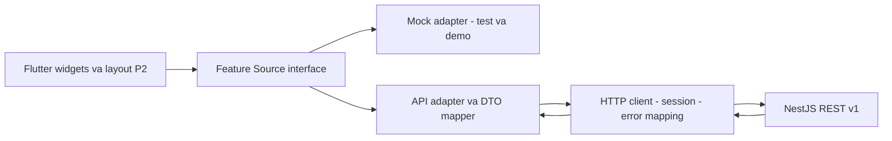

# Flutter integration và roadmap - PROPOSED

> Scope update 2026-11-04: This document contains historical milestones. For the current FE scope, removals and remaining integration work, use [FE-SCOPE-CLEANUP.md](../FE-SCOPE-CLEANUP.md). Blog/digital products/advanced marketing are excluded; do not restore them from this history.

Không có sửa đổi Flutter trong Phase 1. Tài liệu này xác định nơi cần thay khi nhóm duyệt, không cam kết đổi URL là đủ. Xem [ADR](PHASE-1.md), [API](API-CONTRACT.md), [ERD/state](DATA-MODEL.md).

## 1. Ranh giới tích hợp

Giữ feature/presentation/widget và P2 tokens hiện tại. Bổ sung tầng DTO decoder → application model/view adapter → feature Source/Repository; request chỉ qua API client có auth/error/idempotency interceptor. HTTP library, serializer/code generator và state library chưa chọn.

Mock/API là lựa chọn rõ tại composition root theo môi trường/feature. Không fallback tự động sang mock khi API fail: làm vậy có thể hiện paid/đơn seed/stock giả. Không trộn mock order với product thật hoặc user thật. Feature chưa tích hợp dùng demo mode riêng/notice, không làm API catalog thật và COD mock thành luồng thanh toán tưởng là thật.

### Các seam hiện tại và thay đổi tối thiểu

| Module/port hiện tại | API adapter đề xuất | Thay đổi wiring cần thiết; giữ lại |
| --- | --- | --- |
| LenlabRepository.products(bool) | CatalogSource.query + detail/variants | Chữ ký hiện không có query/page; bổ sung query/result DTO, chuyển search/filter/page khỏi danh sách local; giữ CatalogProductCard/Grid/Header |
| LenlabRepository.signIn→void | AuthSource → SessionResult | Không nhét token vào biến signedIn; store/session nhận principal UUID/capabilities. Giữ login/register layout/field validation |
| LenlabStore cart mutations | CartRepository + cart snapshot/version | Mutation async, pending/rollback/reload cho conflict; selection gắn cartItemId. Giữ cart card/quantity/selection UI |
| OrderReviewSource.preview(subtotal,discount,address) | CheckoutQuoteSource.preview(CheckoutDraft) | Input phải có selected cart IDs/version/address/shipping/voucher; giữ OrderReviewTotals làm display mapper nhưng lưu quoteId/version/expiry riêng |
| CodOrderSource.submit(CodOrderDraft) | OrderRepository.create(quoteId,method,note,key) | Không gửi client ID/price/discount làm authority; mở rộng port hoặc wrap command trước khi adapter gọi. Giữ success/receipt widgets và retry UI |
| BankTransferSource.preview | PaymentSource.create/readAttempt | Có order/intent IDs thật rồi instructions; không tái dùng preview mock làm provider API. Giữ QR/details layout; nội dung waiting/error cần task UI riêng |
| OrderListSource/OrderDetailSource | ApiOrderListSource/ApiOrderDetailSource | Query/ownership/timeline từ server, mapper snapshot. Giữ list/detail cards và Back |
| ProfileEditorSource | ApiProfileEditorSource | ID/version, upload media rồi profile save; giữ draft/cancel/error behavior; email readonly như hiện tại |
| AddressBook/Editor/CheckoutAddressSource | ApiAddressSource/Actions | ID/version thay object identity/index; region source version; default/delete atomic server. Giữ form/card, không sửa snapshot đơn |
| VoucherSource/CartVoucher | ApiVoucherSource + quote eligibility | Card status do server; apply vào CheckoutDraft rồi requote. Không set coupon hardcode; giữ ticket hình dáng đã duyệt |
| ReviewSource/PostPurchaseReviewSource | ApiReviewSource/ReviewCommands | Server summary/pagination, eligibility endpoint, media IDs; source hiện save→void cần result server ID hoặc reload thay local fake append. Giữ form sao/text/preview |
| LibrarySource | ApiLibrarySource/AccessGrantSource | Entitlements, typed digital metadata, access request. Giữ LibraryCard, không tự tính canDownload từ local payment |
| AdminAuthSource/AdminSession | ApiAdminAuthSource/SessionAdapter | Resolve cùng principal/permissions, admin guard không chỉ signedIn; giữ mẫu login xanh và shell |
| AdminProductsSource/AdminOrdersSource/... | ApiAdmin*Source | Interfaces query/detail khá phù hợp; thêm mapping payment/version/availableActions. Không vì thay Source mà tự bật các nút đang chỉ đọc |
| LenlabRepository.submitProof/confirmPayment | Không tạo API tương ứng | Giữ legacy mock để tương thích test đến khi task cleanup được duyệt; API adapter nếu buộc satisfy port thì fail rõ Unsupported, không giả thành công |
| LenlabRepository.download | Entitlement access API | Không tải bằng toàn bộ Order client; kiểm quyền từng entitlement server, link private có hạn |

Không giữ `if repository is MockLenlabRepository` trong business flow API; chuyển thành injection của feature source tại composition root. Hiện nhiều source mặc định khởi tạo trong widget, nên sẽ cần thêm factory/provider seam. Không yêu cầu thay ChangeNotifier bằng framework khác.

## 2. Mapping Flutter ↔ Backend DTO

| Flutter hiện tại | Backend DTO/model | Quy tắc mapping |
| --- | --- | --- |
| CustomerProfile.email dùng nhận diện actor | UserDto.id + identity subject | Dùng user UUID cho ownership; email chỉ hiển thị, có thể null nếu login phone |
| signedIn boolean | SessionState authenticated/unauthenticated/refreshing | Derive từ session hợp lệ, không set true sau request void |
| Product.id/name/category | ProductDto.id/name/category.id/key/name | Không đổi product ID theo tên; label category không làm key |
| Product.price/oldPrice | Selected VariantDto.price/compareAtPrice hoặc list priceRange | Display amount theo variant; không đặt tất cả variant về một giá. Không ngầm dùng minPrice làm giá variant |
| Product.stock | VariantAvailability.availableQuantity | Tránh default stock=45 khi JSON thiếu. Không aggregate stock product rồi cho variant đó mua toàn bộ |
| Product.digital / format string | ProductDto.kind + DigitalMetadata.type,size,duration | Format chỉ là display; không suy digital từ chuỗi format nullable |
| Product.image/P2Asset alias | MediaDto URL/local bundled reference union | Cần media rendering adapter hỗ trợ network/loading/error; giữ slot/radius/fit, không coi URL là tên file asset |
| Product.rating / ReviewCollection tính local | ReviewSummaryDto average/count/distribution | Không tính rating tổng từ riêng trang review đang tải. API summary là nguồn chuẩn |
| CartLine.product + variant string/key | CartLineDto.id + variantId + options + quantity/version | Chuỗi 'Kem · 180cm' chỉ label. Không split label để tìm SKU hoặc gộp key bằng text |
| Address object không ID | AddressDto.id/version + AddressSnapshot | Tách saved record khỏi snapshot; editor truyền ID/version thay index/reference |
| Order.id | OrderDto.id và code | Route/API dùng UUID; code hiển thị như mã WOOL/ORD chỉ nếu backend cấp |
| Order.lines CartLine mutable | OrderItemSnapshotDto | Giá/tên/options/ảnh theo snapshot. Không dùng live Product.price để tính order.total |
| Order.shipping/discount/subtotal/total | TotalsDto | discount UI = itemsDiscount+shippingDiscount nếu nhãn tổng; tránh trừ discount hai lần |
| Order.state | OrderStatusDto | Map 5 trạng thái cùng nghĩa; unknown enum hiển thị không xác định/fail decode có telemetry, không default pending |
| Order.payment | PaymentSummaryDto.method + collectionStatus + resolutionStatus | Bắt buộc tách model/adapter. Không map mọi unpaid sang awaitingProof hoặc mọi paid sang bank transfer |
| Order.proof / Attachment | Không có payment proof DTO | Media attachment hợp lệ của Custom/review là các purpose khác, không cùng endpoint bill |
| Order.canDownload | EntitlementDto.actions | Không gán quyền bằng confirmed trong app; backend cho phép access mới mở/tải |
| QuoteState và CustomRequest.price/image | CustomRequestDto + QuoteRevisionDto + referenceMedia | ACCEPTED không đồng nghĩa PAID; chưa có quote thì amount null, không mặc định 550000 |
| ReviewDraft.authorId/email, local generated review ID | Principal + server ReviewDto.id | Bỏ authorId khỏi request; server quyết eligibility và unique. Giữ preview bytes cục bộ đến upload/save thành công |
| Profile.avatarBytes/review localPhotos | Local draft + ready mediaId | Chọn/xem trước không đồng nghĩa đã upload; lỗi save không làm mất draft; file orphan cleanup theo policy |
| AdminOrderPayment.cod/bankTransfer | PaymentSummaryDto.method và status riêng | Thêm VNPAY; phải chỉnh data model/binding label/filter tối thiểu, không thể map không mất thông tin vào enum hai giá trị |
| AdminOrderStatus thiếu processing | Admin OrderStatusDto | Thêm PROCESSING hoặc có group filter documented; không ép processing thành shipping |
| InternalNote trong CustomRequest shared | Admin-only DTO | Customer mapper tuyệt đối không nhận field này |

Giữ display adapters tương thích dần, nhưng không duy trì model cũ khi nó làm mất nghĩa tài chính. Phần phải sửa ở phase tích hợp là model/port/state orchestration và binding nhãn, không phải dựng lại toàn bộ giao diện.

### Mapping legacy payment - chỉ dùng kiểm thử/migration dữ liệu demo

| Legacy value | Có thể suy ra | Không được suy ra |
| --- | --- | --- |
| cod | method COD | Chưa biết đã thu tiền hay chưa |
| awaitingProof | Legacy bank flow, chưa xác nhận | Không tạo yêu cầu upload proof mới |
| awaitingReview | Legacy đang chờ kiểm tra | Không coi đã có bank transaction verified |
| confirmed | Mock hiển thị xác nhận | Không import thành receipt hoặc entitlement production |
| rejected | Legacy rejection | Không map mặc định sang VNPay failed hoặc bank reversed |

Production không import tiền/quyền từ seed. Nếu cần dữ liệu demo giống UI, tạo fixture sandbox có đánh dấu riêng, không tạo receipt tiền thật.

## 3. Integration flow đề xuất

1. Catalog API → chọn variant ID → add/update cart server. Flutter giữ local selected IDs và form draft.
2. Checkout draft chứa cart/version/selected item IDs/address version/voucher/shipping; quote server trả totals, expiry và available methods.
3. Khách xác nhận; client giữ Idempotency-Key xuyên retry. Create order dùng quote, không client prices/ID.
4. COD mở success với OrderDto server, không báo đã thanh toán. Online tạo attempt; app mở provider hoặc bank instructions đúng method.
5. Quay về/resume/nhấn xem đơn → đọc server payment status. Pending hiển thị pending; chưa biết kết quả không biến thành failure hoặc success.
6. Customer và admin đọc cùng UUID/API/database; frontend không truyền record thẳng từ app sang admin.
7. Order complete/paid effect được backend xử lý theo từng policy; review eligibility và digital entitlement không do app tự cấp.

Login/logout/đổi tài khoản phải clear/reload caches theo principal UUID; không để đơn/địa chỉ/quyền customer trước xuất hiện trong phiên sau. Cart guest merge chỉ triển khai khi D12 chốt.

## 4. Roadmap theo dependencies

### P0 - hợp đồng, nền tảng và MVP mua hàng

| Bước | Backend design/implementation sau duyệt | FE integration sau duyệt | Dependency/gate |
| --- | --- | --- | --- |
| 0 | Duyệt ADR, vocabulary, invariants; freeze OpenAPI draft | Duyệt mapping enum/ID, xác định API/demo modes | D01-D07/D11-D15 phần liên quan |
| 1 | Dev Supabase project riêng, ORM/query choice, schema/migration review, env/secrets/CI | Không chứa credentials; cấu hình base URL môi trường | D11 và project development chưa tồn tại |
| 2 | Identity/AuthProvider, users, RBAC, ownership, exception/request IDs | Session adapters/guards và cache isolation; giữ layout | D01-D02/D13 |
| 3 | Categories/products/variants/media read, inventory balance read | Catalog/detail/server pagination/variant ID | D10/D15; không sinh SKU từ mock |
| 4 | Addresses và Cart CRUD/version | Form/card source thay API, async mutations | D07/D12 |
| 5 | Voucher policy + Shipping adapter + CheckoutQuote | Apply voucher, totals server, stale/conflict handling | D04-D05-D07; cần pricing/catalog |
| 6 | Inventory transactions + Orders + COD + outbox/idempotency | Create COD thật, success từ server, selected-line cleanup đúng policy | D03-D04-D13 |
| 7 | Payment intent/attempt/inbox/receipt/allocation + VNPay sandbox + bank adapter | Payment method/return/pending/retry, tách bank/VNPay | Merchant sandbox, D03/D06; no production transaction |
| 8 | Admin read/transition/payment reconciliation permissions | Thay admin sources, bật từng action bằng task riêng | Steps 2/6/7; trạng thái shared vocabulary |

Core library được tạo từng module, không viết mọi endpoint một lượt. Backend không có trước thì FE API contract tests dùng fake HTTP server/fixtures phân biệt rõ, không giả đã tích hợp database.

### P1 - nghiệm thu và module được đưa vào demo

1. Contract tests DTO/schema/error/auth/permissions; mapping tests Flutter; concurrency tests tồn/voucher/idempotency/payment.
2. Android sandbox return/resume/process-death/network; admin desktop/Back/refresh/expired session/CSRF; không thay audit bằng unit tests.
3. Media/reviews sau khi D10 chốt, giữ 5 ảnh/5 MiB và một review/product/order. Verify upload và order ownership thực.
4. Custom request/quote/version/ảnh mẫu và Gemini+FAQ nếu D08-D09 xác nhận demo bắt buộc. Custom không phụ thuộc chatbot để lưu yêu cầu; business API có thể dùng độc lập.
5. Digital checkout/entitlement/private access nếu được duyệt; không dùng file email thay quyền một cách ngầm định.
6. Reconciliation exception UI, logging redaction, metrics/inbox lag, recovery runbook; policy và nhãn hiển thị đủ chính xác.

### P2 - sau MVP hoặc chưa phê duyệt

Refund/return/deposit/partial payment, nhiều kho/split shipment, gateway method switching phức tạp, guest merge, chatbot streaming/human handoff, dashboard nâng cao, abandoned carts/marketing/CMS đầy đủ. Chỉ chuyển lên P0/P1 khi nhóm duyệt; không xóa màn đã có.

## 5. Acceptance/test plan - chưa thực thi trong giai đoạn thiết kế

| Kịch bản | Kết quả bắt buộc của phương án được duyệt |
| --- | --- |
| Hai user mua đơn vị cuối cùng | Một reservation thành công; request kia OUT_OF_STOCK, không balance âm |
| Cùng SKU nhiều cart lines/biến thể | Demand gộp theo variant ID; không vượt tồn vì check rời từng line |
| Giá/stock/address/cart đổi sau quote | Reject stale/requote; giữ draft, không âm thầm đổi giá hoặc xóa cart mới |
| Gửi create order trùng/mất response | Một order, cùng key replay; quote unique bảo vệ sau TTL |
| Cùng key khác request | 409, không mutate |
| Callback VNPay lặp/đảo thứ tự | Một allocation/effect; failure muộn không downgrade receipt success |
| Invalid checksum/amount/reference/merchant | Không mark Paid; ack/error theo provider, có audit an toàn |
| Return trước IPN hoặc app bị kill | FE chờ/đọc server; không dựa return query để xác nhận |
| Expiry worker đua IPN | Một kết quả tài chính nhất quán; receipt luôn giữ, paid-late vào review nếu mất hold |
| Hai attempt cùng trả tiền | Ghi đủ cả receipts, không fulfill/cấp quyền hai lần; extra receipt review |
| Bank transaction match hai đơn | Unique allocation chặn; manual match vẫn kiểm source/amount/permission |
| COD delivered chưa có collection | Order DELIVERED nhưng collection chưa PAID; UI không nói đã thu tiền |
| Voucher lượt cuối race/cancel/retry | Quota atomic, claim không consume/release hai lần; trigger theo D05 |
| Custom chưa trả tiền | Request/history/ảnh vẫn tồn tại theo D08 được duyệt, không auto delete |
| Đổi quote revision khi user đang chốt | Conflict; không accept giá cũ vô tình |
| Đổi account/direct URL order người khác | Server không trả dữ liệu; FE cache không rò phiên trước |
| Giả role hoặc sửa payment JSON | Không cấp quyền/mark Paid; server rejects field và role tự khai |
| Review chưa mua/chưa delivered/gửi đồng thời | Backend từ chối hoặc một review thành công theo unique rule |
| File review giả MIME/quá giới hạn | Server rejects; không cấp URL public hoặc ghi review không hợp lệ |
| Digital chưa có entitlement hoặc bị thu hồi | Access grant bị từ chối, dù app local có confirmed |
| Gemini timeout/429/invalid output/prompt injection | FAQ/degraded rõ source, không thao tác tài chính, không lộ secret |
| API outage | UI error/retry; tuyệt đối không fallback seed mock thành dữ liệu thật |

## 6. Ranh giới hoàn thành Phase 1

Đã có bản đề xuất ADR, ERD, contract/DTO, state matrix, mapping, roadmap và approval register. Chưa có OpenAPI executable, SQL migration, NestJS module, API repository Flutter, sandbox payment hay kết quả kiểm thử tích hợp. Phase 2 chỉ bắt đầu sau khi nhóm phê duyệt các quyết định liên quan; tài liệu không tự cấp phép triển khai.
