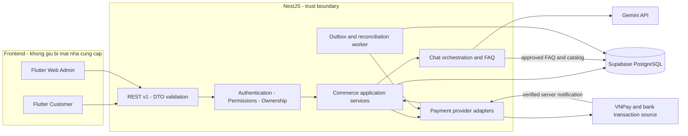

# LENLAB - Phase 1: Backend Contract & Data Model Design

> Scope update 2026-11-04: This document contains historical milestones. For the current FE scope, removals and remaining integration work, use [FE-SCOPE-CLEANUP.md](../FE-SCOPE-CLEANUP.md). Blog/digital products/advanced marketing are excluded; do not restore them from this history.

Ngày lập: 04/11/2026. Trạng thái: **DRAFT - FOR REVIEW, chưa phê duyệt để triển khai**.

Đây là tài liệu thiết kế. Không có backend, schema, migration, database, UI hoặc mock nào được triển khai/thay đổi bởi tài liệu này.

## 1. Bộ tài liệu và cách đọc

1. Tài liệu này: nguồn, kiến trúc, ADR, phạm vi và danh sách quyết định.
2. [DATA-MODEL.md](DATA-MODEL.md): ERD PostgreSQL, bảng, ràng buộc và lifecycle tồn kho/thanh toán/Custom.
3. [API-CONTRACT.md](API-CONTRACT.md): REST endpoints, DTO, lỗi, auth và xác minh thanh toán.
4. [FLUTTER-INTEGRATION.md](FLUTTER-INTEGRATION.md): mapping, thay mock từng phần, roadmap và tiêu chí nghiệm thu.

Quy ước:

- **CONFIRMED**: yêu cầu/quyết định đã được chủ dự án xác nhận.
- **PROPOSED**: phương án kiến trúc trong bộ tài liệu này; chưa phải quyết định đã duyệt.
- **OPEN Dxx**: thiếu quyết định nhóm, không được dùng ví dụ hoặc schema đề xuất để tự chốt.
- **NOT VERIFIED**: chưa có nguồn, môi trường hoặc credential để xác minh.

Tất cả tên bảng, endpoint, enum, DTO và tham số cấu hình dưới đây là PROPOSED, trừ khi đánh dấu riêng. P0/P1/P2 là thứ tự dự kiến, không tự bổ sung phạm vi đã phê duyệt.

## 2. Nguồn và hiện trạng kiểm chứng

Nguồn ưu tiên: yêu cầu Phase 1 hiện tại và các quyết định xác nhận trong trao đổi → `docs/Mobile.docx` → các phần không mâu thuẫn của tài liệu cũ → code để xác định hiện trạng. Báo cáo FE Audit trong cuộc trao đổi là đầu vào phát hiện, đã kiểm tra lại các model/port trọng yếu.

### 2.1 CONFIRMED

| Nội dung | Phạm vi xác nhận |
| --- | --- |
| Công nghệ | Flutter/Dart customer; Flutter Web/Dart admin; NestJS/TypeScript; Supabase PostgreSQL; REST/HTTPS; Gemini gọi qua NestJS |
| Thanh toán | Thiết kế COD, bank transfer và VNPay thành các phương thức riêng; FE không tự xác nhận Paid |
| Biên lai | Đã bỏ UI upload bill; không dùng bill khách gửi làm căn cứ xác nhận tiền |
| Giỏ | Checkout theo các dòng chọn; giữ dòng không mua; không dùng thiết kế tích hợp để xóa toàn bộ giỏ |
| Mua lại | Mở detail sản phẩm hiện tại để chọn lại; không tự thêm lại dòng cũ |
| Đánh giá | Đăng nhập, đúng sản phẩm trong đơn đã giao, một lần mỗi sản phẩm/đơn; chưa sửa review |
| Ảnh review | Tối đa 5 JPG/PNG, mỗi ảnh tối đa 5×1024×1024 byte; không áp quy tắc này sang avatar/Custom |
| Địa chỉ | Không xóa địa chỉ mặc định trực tiếp; chọn mặc định khác trước; sửa sổ không sửa snapshot đơn |
| Customer hủy đơn | Nút đã được yêu cầu bỏ; không tự mở lại trong thiết kế FE |
| Supabase | Chưa có development project; chưa có kết nối database |

### 2.2 Mobile.docx có đề xuất cần nhóm chốt

Giữ yêu cầu Custom chưa trả tiền; cấp nội dung số trong app thay email file; thời điểm giữ/trừ/hoàn kho; mức ưu tiên FAQ/Gemini; cắt giảm các module admin nâng cao. Đề xuất của tài liệu không đồng nghĩa toàn bộ chi tiết đã được duyệt.

`docs/PAYMENTS.md` vẫn ghi chưa chọn cổng; yêu cầu Phase 1 hiện tại đã chỉ định thiết kế VNPay. Cập nhật hướng thiết kế theo yêu cầu mới, không kết luận đã có hợp đồng merchant hay môi trường sandbox.

### 2.3 Bằng chứng code

| Code hiện tại | Kết luận thiết kế |
| --- | --- |
| `packages/lenlab_shared/lib/src/domain/models.dart` | Product có stock cấp sản phẩm, variant là chuỗi; Address không ID; PaymentState trộn phương thức/trạng thái; Order dùng Product mutable |
| `packages/lenlab_shared/lib/src/data/lenlab_repository.dart` | Port còn submitProof/confirmPayment; signIn trả void; products không có query/page |
| `packages/lenlab_shared/lib/src/state/lenlab_store.dart` | Có seed, signedIn boolean, tổng tiền/client ID và state mutation; không phải nguồn xác thực giao dịch |
| `packages/lenlab_shared/lib/src/data/cod_order_data.dart` | Có snapshot line và CodOrderSource, thuận lợi để giữ presentation; chưa phải contract đặt đơn server |
| `packages/lenlab_shared/lib/src/data/order_review_data.dart` | preview chỉ nhận subtotal/discount/address; phải mở rộng input khi quote server |
| `apps/customer/lib/features/address_book/data/*` | Xác định record bằng object/index; cần addressId/version |
| `apps/customer/lib/features/reviews/data/review_order_source.dart` | Kiểm tra local eligibility; backend phải xác minh ownership lại |
| `apps/customer/lib/features/library/data/library_source.dart` | Quyền derive từ đơn mock; không dùng làm entitlement production |
| `apps/admin/lib/features/orders/data/admin_order_summary.dart` | Có status đơn và COD/CK, chưa có payment status riêng |
| `apps/admin/lib/app.dart` | Nhiều Source có injection; có thể thay từng module |

### 2.4 NOT VERIFIED

Chưa có Supabase schema; NestJS chưa được triển khai; chưa chốt ORM, auth provider, storage hoặc state-management cuối. Chưa có merchant VNPay/key/sandbox credentials, ngân hàng/đối tác đối soát, shipping provider, Gemini project/model/quota. Chưa có bản SRS mới độc lập để kiểm tra đầy đủ các PAY/BR/UI mà Mobile.docx tham chiếu.

## 3. Kiến trúc đề xuất

**PROPOSED: modular monolith NestJS**, một PostgreSQL, API chung cho hai frontend; tránh chia microservice khi chưa có nhu cầu vận hành.

- Module ranh giới: Identity/Access, Users/Addresses, Catalog, Inventory, Cart, Checkout, Orders, Payments, Vouchers; Custom, Media, Reviews, Entitlements, Chat là các module nối tiếp theo scope.
- Controller chỉ nhận DTO/auth context; application service điều phối transaction; domain rule không đặt trong Flutter hoặc ORM entity callback.
- PostgreSQL là nguồn chuẩn cho đơn, giá quote, reservation, payment ledger, voucher và quyền. Job dùng DB outbox/inbox ban đầu; chưa mặc định thêm Redis/BullMQ.
- Object storage là cổng tùy chọn cần duyệt nhà cung cấp; không lưu byte ảnh/file nội dung trong bảng order/payment.
- Bên ngoài transaction chỉ gọi network qua adapter. Không giữ khóa database trong lúc gọi VNPay/Gemini/ngân hàng.
- Flutter không kết nối trực tiếp bảng commerce hoặc giữ DB connection string, service role, payment secret, Gemini key.

## 4. Architecture Decision Records

Mọi ADR PROPOSED đều cần nhóm duyệt. Ghi rõ lý do, hệ quả và phương án thay thế để tránh biến lựa chọn kỹ thuật thành quyết định ngầm.

| ADR | Trạng thái | Quyết định/phương án | Lý do, hệ quả và phương án thay thế |
| --- | --- | --- | --- |
| 001 | CONFIRMED | Giữ stack bắt buộc và Gemini qua NestJS | Không đổi sang Laravel/React/Firebase; Supabase PostgreSQL không tự đồng nghĩa dùng Supabase Auth/Storage |
| 002 | PROPOSED | Modular monolith, module/service/repository rõ ranh giới | Một deployment dễ vận hành, transaction commerce thống nhất; microservice chỉ cân nhắc khi có dữ liệu tải/vận hành |
| 003 | PROPOSED | REST `/api/v1`, OpenAPI làm contract, generated client là tùy chọn | DTO tách DB entity và Flutter view model; chọn công cụ generate chưa bắt buộc |
| 004 | PROPOSED | SKU/variant là đơn vị bán và tồn; product chỉ nhóm nội dung | Sản phẩm không tùy chọn vẫn có default variant; không tạo tổ hợp Merino hay biến thể sản phẩm khác từ chuỗi mẫu khi chưa duyệt catalog |
| 005 | PROPOSED | Quote server và immutable order snapshot | Chặn giá/ship/voucher client; cần sửa data input/mapper nhưng giữ widget. Không lấy live Product để tính lại đơn lịch sử |
| 006 | PROPOSED / OPEN D03-D04 | Order state, payment method, collection status và attempt state độc lập | Không suy delivered ⇒ paid hoặc paid ⇒ shipped. Enum chi tiết và policy transition vẫn cần duyệt |
| 007 | PROPOSED / OPEN D04 | Reserve ở lúc tạo đơn, allocate khi đủ điều kiện, physical issue lúc ship | `available=onHand-reserved`, xem matrix. Thay thế: issue lúc paid với định nghĩa balance khác; không trộn hai cách |
| 008 | PROPOSED | Payment inbox/ledger + server verification + idempotency | Webhook trùng/late phải an toàn; không có endpoint nhận `paid:true` từ customer |
| 009 | PROPOSED / OPEN D01 | AuthProvider port; ưu tiên xem xét Supabase Auth sau NestJS facade | Giảm tự quản password; chỉ là đề xuất. Phương án B NestJS identity/session riêng; ORM/hash lib/verification chưa chọn |
| 010 | PROPOSED | Permission + ownership ở NestJS, database role tối thiểu | RBAC không chỉ ẩn menu. Role từ server, không từ user_metadata tự sửa. DB RLS không thay thế service guard |
| 011 | PROPOSED / OPEN D10 | Media qua upload-intent, server validation, storage adapter | Tách CUSTOM_REFERENCE/REVIEW_IMAGE/AVATAR/DIGITAL_CONTENT; không tạo PAYMENT_PROOF purpose |
| 012 | PROPOSED / OPEN D08-D09 | Gemini orchestration, FAQ fallback, action cần xác nhận rõ | Không để AI chốt giá, tạo payment, cấp quyền hoặc sửa đơn. Không chốt model/SDK/công thức ước tính |
| 013 | PROPOSED | Giữ mock song song API adapter, thay theo feature | Cần thêm ID/enum/query và injection seam, không hứa zero-change; không trộn đơn mock với order thật |
| 014 | DEFERRED | ORM, state management, auth/storage cụ thể, queue infra | Chưa có phê duyệt; không thêm Prisma/TypeORM/Riverpod/Supabase SDK vào baseline chỉ vì xuất hiện trong ví dụ |

## 5. Authentication và RBAC đề xuất

### 5.1 Ranh giới xác thực

Contract frontend dùng cùng Auth API; implementation sau `AuthProvider` tùy D01. `users.id` là UUID nội bộ ổn định; `identities(provider, subject)` ánh xạ subject bên ngoài, không dùng email làm FK/ownership.

PROPOSED A: Supabase Auth quản credential, NestJS xác minh token rồi ánh xạ sang user/roles. Nếu khóa ký bất đối xứng, xác minh JWT bằng JWKS và kiểm tra issuer, audience, expiry; không chỉ decode token. Nếu signing config khác, phải chọn phương thức xác minh tương ứng. Xem [Supabase JWT docs](https://supabase.com/docs/guides/auth/jwts).

PROPOSED B: NestJS quản credential/session, password hash phù hợp và reset/verification riêng. Không tự triển khai cryptography. Đưa security review và rotation vào scope nếu chọn B.

API auth public không cho khách đăng ký role admin. Admin bootstrap qua quy trình vận hành được duyệt; không copy credential mock vào seed production. Registration phản hồi challenge/verification thay vì giả định luôn auto-login. Email/phone/password/OAuth khả dụng theo capabilities, không mở phương thức chưa được cấu hình.

### 5.2 Session transport - OPEN D02

- Mobile đề xuất access token ngắn hạn trong memory, refresh credential trong secure OS storage; SDK secure storage chưa chọn.
- Admin web đề xuất cùng origin qua reverse proxy, session cookie HttpOnly/Secure/SameSite phù hợp, anti-CSRF cho request ghi; Flutter Web không giữ refresh token trong localStorage.
- Hai loại session cùng resolve server user/permission, response DTO phân biệt transport. Không bắt web nhận mobile refresh token JSON.
- Refresh rotation/revocation theo provider; mobile single-flight refresh, retry request chỉ khi an toàn, giữ Idempotency-Key khi retry command.
- Logout/revoke/blocked user phải vô hiệu hóa quyền; server kiểm tra user status và permission version, tránh role cũ trong token vẫn được thao tác nhạy cảm.
- TTL token/session, remember-me, OTP, MFA admin, reset password và login email/phone cần D01-D02; không ghi con số làm rule đã chốt.

### 5.3 Ma trận quyền tối thiểu

Hai role đề xuất ban đầu CUSTOMER/ADMIN; permission vẫn riêng để có thể thu hẹp admin sau. Không tự thêm role kế toán/support vào MVP.

| Resource/action | Public | Customer | Admin có permission |
| --- | --- | --- | --- |
| Catalog published | Đọc | Đọc | Đọc; unpublished chỉ `catalog:read_private` |
| Profile/address/cart/order/payment | Không | Chỉ tài nguyên sở hữu | Chỉ qua admin endpoint và permission tương ứng |
| Sửa catalog/inventory | Không | Không | `catalog:write`, `inventory:adjust` |
| Confirm/ship/deliver/cancel đơn | Không | Chưa mở endpoint hủy | `orders:transition` + guard trạng thái |
| Đối soát bank/COD | Không | Không | `payments:reconcile`; vẫn phải có nguồn giao dịch/thu tiền hợp lệ |
| Voucher quản trị | Không | Chỉ xem eligibility của mình | `vouchers:write` |
| Review | Đọc published | Tạo theo điều kiện đã chốt | `reviews:moderate`, scope cần duyệt |
| Custom/chat/library | Tùy D08-D09 | Ownership bắt buộc | Permission module tương ứng |
| VNPay/bank webhook | Không cần user JWT | Không | Route provider riêng, xác minh provider; không phải public business command |

Thiếu session: 401; có session nhưng thiếu permission: 403; tài nguyên không thuộc user: đáp ứng 404 theo policy nhất quán để hạn chế dò ID. Ownership phải nằm trong query/service, không chỉ decorator. Quy tắc guard authentication trước authorization dựa trên [NestJS authorization](https://docs.nestjs.com/security/authorization); không chốt package auth cụ thể.

### 5.4 Supabase/PostgreSQL boundary

Đề xuất commerce schema không expose trực tiếp qua Data API; nếu expose phải có RLS và revoke grants phù hợp. NestJS dùng DB role giới hạn, không mặc định service-role/superuser cho mọi request. Identity của request không tự xuất hiện trong PostgreSQL chỉ vì NestJS đã xác minh JWT: ownership query hoặc transaction-local context/RLS phải được thiết kế và kiểm thử rõ. Service key bypass RLS chỉ dùng backend task cần thiết nếu được duyệt, không gửi frontend.

## 6. Các quyết định còn mở - approval register

| ID | Quyết định chưa chốt | Khuyến nghị để nhóm xem xét | Module bị chặn |
| --- | --- | --- | --- |
| D01 | Auth provider; email/phone/OTP, verification, reset, admin bootstrap/MFA | So sánh Supabase Auth facade và NestJS auth; giữ application user UUID riêng | Identity và mọi integration có tài khoản |
| D02 | Mobile/web session transport, TTL, CSRF, remember-me, hosting domains | Mobile secure storage; admin cookie cùng origin; không chốt TTL trước threat model | Auth clients/deployment |
| D03 | Lúc tạo order online, bỏ dòng giỏ, đổi phương thức, retry/hết hạn/hủy | Quote → order chờ tiền → attempts; giữ request Custom; method change chưa mở | Checkout/payments |
| D04 | Reserve/allocate/issue/release, TTL, COD guard, paid late/out-of-stock | Phương án ADR-007; paid-late vào review, không tự giao hoặc làm mất tiền | Inventory/orders/payments |
| D05 | Voucher min/cap/số lượt/per-user/stack/COD consume/expiry/cancel release | Một policy engine có rule version; ví dụ không phải rule thật | Voucher/quote |
| D06 | Bank/tài khoản shop, nguồn statement/API/webhook, ai xác nhận, lệch tiền | Chỉ reconcile từ giao dịch thực đã xác minh; không bill khách | Bank transfer |
| D07 | Shipping provider, phí/miễn phí, vùng địa chỉ chuẩn, thuế/phụ phí | Shipping quote adapter; không dùng 30.000đ cố định làm business rule | Checkout totals |
| D08 | Custom trong MVP, quote versions/deposit/full pay/sản xuất/từ chối/ảnh mẫu | Giữ request độc lập với order/payment; full vs deposit chưa chọn | Custom |
| D09 | Digital/chat trong MVP; quyền/refund/email; FAQ/AI/ước tính len | Entitlement backend; Gemini read-only tools + FAQ; công thức do nhóm duyệt | Digital/Chat |
| D10 | Storage, URL public/private, avatar/Custom file rules/retention | Upload-intent theo purpose; review giữ giới hạn đã chốt | Media |
| D11 | ORM/query builder, migrations, test DB, secrets/deployment | Chọn sau spike transaction/concurrency; không mặc định Prisma | Backend foundation |
| D12 | Guest checkout/cart merge/cross-device cart | Contract P0 dưới đây viết cho user đã xác thực; không suy ra đã cấm guest | Cart/auth/checkout |
| D13 | RBAC chi tiết, admin MVP, ngân hàng/COD collection, audit retention | Tách permission thu tiền và vận hành đơn; admin bootstrap hạn chế | Admin |
| D14 | Refund/return, payment excess/partial, dispute, đơn 0đ | Thiết kế sẵn ledger; không mở refund hoặc coi 0đ là paid khi chưa duyệt | Payments mở rộng |
| D15 | SKU/catalog mapping, phân loại digital, single/mixed cart, version giá | Xác minh dữ liệu thật, không chuyển chuỗi variant mock thành SKU tự động | Catalog/import |

Các trạng thái/route được đề xuất trong tài liệu chỉ có thể được code sau khi duyệt các D liên quan. Không vì thiếu quyết định mà tự xóa màn hoặc mock đã có.

## 7. Nguồn kỹ thuật và giới hạn xác minh

- [NestJS authentication](https://docs.nestjs.com/security/authentication), [authorization](https://docs.nestjs.com/security/authorization): đã tra qua Context7, không pin NestJS major/package mới trong tài liệu này.
- [Supabase JWT](https://supabase.com/docs/guides/auth/jwts), [RLS](https://supabase.com/docs/guides/database/postgres/row-level-security): đã tra tài liệu; chưa kiểm tra trên project thực.
- [PostgreSQL row locking](https://www.postgresql.org/docs/current/explicit-locking.html): căn cứ kỹ thuật transaction, không quyết định thời điểm trừ kho kinh doanh.
- [VNPay PAY 2.1.0](https://sandbox.vnpayment.vn/apis/docs/thanh-toan-pay/pay.html): web reader timeout; đã đọc được trang chính thức bằng HTTPS từ môi trường local. Chưa test merchant sandbox; phải đối chiếu lại đúng gói tích hợp được cấp trước khi code.
- [Gemini API key](https://ai.google.dev/gemini-api/docs/api-key), [troubleshooting](https://ai.google.dev/gemini-api/docs/troubleshooting): đã đọc; không chọn model, quota hoặc tài khoản thay nhóm.

Không có ERD/schema hiện hữu để reverse-engineer trên Supabase. ERD là đề xuất mới, không phải kết quả introspection. Không chạy migration/SQL/API thanh toán/Gemini trong Phase 1.
